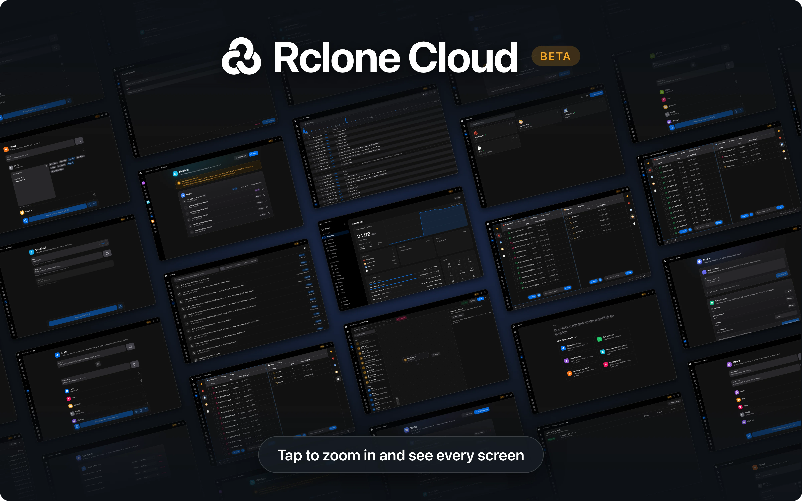

<picture>
    <source media="(prefers-color-scheme: dark)" srcset=".github/assets/beta-banner-dark.svg">
    
</picture>

<br />

Rclone Cloud is a data-transfer platform for organizations. It moves, syncs and serves data
between any of the 70+ storage systems that [rclone](https://rclone.org) supports, from S3,
Azure Blob and Google Cloud Storage to SharePoint, SFTP servers and local disks. A team can run it
with the access control, audit trail and secret handling that a company needs. Projects keep each
team's storage, credentials and work apart. Copies, syncs and moves run on demand or on a
schedule, and workflows chain them, retry them and send notifications.

This repository publishes the beta's Docker image and its
[Linux packages](#install-on-linux-deb-and-rpm), and has its
[issue tracker](https://github.com/rclone/rclone-cloud-beta/issues).

### Enterprise features in the beta

The beta includes every feature, the Enterprise ones too: single sign-on with OpenID Connect,
SAML and LDAP, SCIM provisioning and identity-provider groups, custom roles, external vaults, an
instance key wrapped by your KMS, long audit retention, audit sinks and file-read audit. Please try
them. In the first release, they will be in the paid Enterprise edition only. The open-source
Community edition will have the rest.

## Quick start (Docker)

1. Start Rclone Cloud:

   ```sh
   docker run -d --name rclone-cloud \
       --volume rclone-cloud:/config/rclone-cloud \
       --publish 127.0.0.1:5573:5573 \
       ghcr.io/rclone/rclone-cloud-beta
   ```

2. Open <http://127.0.0.1:5573> and create your account. The first account is the Owner.
3. In **Remotes**, add a remote: a cloud account, a server or a disk. rclone connects to more than
   seventy kinds of storage.
4. Open **Browser**. It shows your files in two panels. Drag files from one panel to the other to
   copy or move them.
5. To invite your team, open **Organization › People › Members**.

The command publishes the app on 127.0.0.1, so only this computer can open it. To open it from other
computers, read [Open it from other computers](#open-it-from-other-computers).



## Proper setup

The quick start is enough to try Rclone Cloud. Before you rely on it, start the container with more
options:

```sh
docker run -d --name rclone-cloud \
    --volume rclone-cloud:/config/rclone-cloud \
    --volume rclone-cloud-key:/config/key \
    --env RCLONE_CLOUD_SECRET_KEY_FILE=/config/key/secret.key \
    --publish 127.0.0.1:5573:5573 \
    --init --stop-timeout 90 --restart unless-stopped \
    ghcr.io/rclone/rclone-cloud-beta
```

- `rclone-cloud-key` keeps the instance key in a volume of its own. The key encrypts the secrets
  that the app stores. With the key kept apart, a copy of the data volume alone cannot open them.
- `--init` cleans up the orphans of the app's child processes.
- `--stop-timeout 90` gives the app time to stop transfers, mounts, serves and the workflow engine.
  Docker's default is 10 seconds.
- `--restart unless-stopped` starts the app again after a crash or a server restart.

If you started with the quick start, move the key out of the data volume first:

```sh
docker stop rclone-cloud && docker rm rclone-cloud
docker run --rm \
    --volume rclone-cloud:/config/rclone-cloud \
    --volume rclone-cloud-key:/config/key \
    ghcr.io/rclone/rclone-cloud-beta secrets move-key --to /config/key/secret.key
```

Then start the container with the command above. The rest of this page uses that command.

## Install on Linux (.deb and .rpm)

To run Rclone Cloud as a service on a Linux server instead of in Docker, download the package for
your machine and `checksums.txt` from the
[releases page](https://github.com/rclone/rclone-cloud-beta/releases):

| Machine | Package |
| --- | --- |
| Debian, Ubuntu (x86-64 / ARM64) | `rclone-cloud_<version>_amd64.deb` / `…_arm64.deb` |
| Fedora, RHEL and the like (x86-64 / ARM64) | `rclone-cloud-<version>.x86_64.rpm` / `….aarch64.rpm` |

The releases also have the binary alone, in `rclone-cloud-v<version>-linux-amd64.tar.gz` and
`…-linux-arm64.tar.gz`.

1. Check the download and install the package:

   ```sh
   sha256sum --check --ignore-missing checksums.txt
   sudo apt install ./rclone-cloud_<version>_amd64.deb    # Fedora: sudo dnf install ./rclone-cloud-<version>.x86_64.rpm
   ```

2. Read the settings in `/etc/default/rclone-cloud` and set the ones you need. The app listens on
   127.0.0.1:5573 unless you set `RCLONE_CLOUD_BIND`. To open it from other computers, read
   [Open it from other computers](#open-it-from-other-computers): the variables are the same.
3. Start the service:

   ```sh
   sudo systemctl enable --now rclone-cloud
   ```

4. Open <http://127.0.0.1:5573> and create your account. The first account is the Owner.

The package installs the `rclone-cloud` command, the workflow engine and a systemd service. The
service runs as the `rclone-cloud` user and keeps its data in `/var/lib/rclone-cloud`. Every
account in the app reads and writes the server's disk as that user, so give it only the folders
that the app's users may reach.

To update, install the next package the same way. It restarts a running service. Back up first.
The backup runs while the app runs, as the service's user and with its settings:

```sh
sudo install -d -o rclone-cloud -g rclone-cloud -m 0700 /var/backups/rclone-cloud
sudo systemd-run --pipe --wait --quiet --uid=rclone-cloud --gid=rclone-cloud \
    -p EnvironmentFile=/etc/default/rclone-cloud -E RCLONE_CLOUD_DATA_DIR=/var/lib/rclone-cloud \
    rclone-cloud backup --to "/var/backups/rclone-cloud/$(date +%Y%m%d-%H%M%S)"
```

The backup leaves the instance key out: keep a copy of `/var/lib/rclone-cloud/secret.key`, or of
the file that `RCLONE_CLOUD_SECRET_KEY_FILE` names.

## Settings

### Variables

Every flag of `serve` also has a variable named `RCLONE_CLOUD_<NAME>`. Give the variables with
`--env`:

| Variable                                      | What it does                                                                          |
| --------------------------------------------- | ------------------------------------------------------------------------------------- |
| `RCLONE_CLOUD_PUBLIC_URL`                     | The address that people open. Links and webhook addresses start with it.              |
| `RCLONE_CLOUD_TRUSTED_PROXY`                  | The proxy addresses whose `X-Forwarded-*` headers the app believes.                   |
| `RCLONE_CLOUD_EMAIL`, `RCLONE_CLOUD_PASSWORD` | Together, they create the Owner at the first start.                                   |
| `RCLONE_CLOUD_IMPORT_RCLONE_CONFIG`           | `true` imports rclone's remotes at start, while the app has none.                     |
| `RCLONE_CLOUD_INSTANCE_CONFIG`                | The file of the instance configuration.                                               |
| `RCLONE_CLOUD_LOG_LEVEL`                      | `debug`, `info` (the default), `notice`, `warning` or `error`.                        |
| `RCLONE_CLOUD_LOG_FORMAT`                     | `text` (the default), or `json` for a log collector.                                  |
| `RCLONE_CLOUD_METRICS_ADDR`                   | The address of `/metrics` and `/debug/pprof/`. It has no sign-in.                     |
| `RCLONE_CLOUD_SECRET_KEY_FILE`                | The file of the instance key.                                                         |
| `RCLONE_CLOUD_SECRET_KEY_KMS`                 | A KMS key that wraps the key file: `awskms://…`, `gcpkms://…` or `azurekeyvault://…`. |
| `RCLONE_CLOUD_ENGINE_DIR`                     | A read-only folder with the workflow engine for a server without internet access.     |

This command lists them all:

```sh
docker run --rm ghcr.io/rclone/rclone-cloud-beta serve --help
```

### Instance configuration

The instance configuration is a YAML file that the app reads at start. Mount it and name it in
`RCLONE_CLOUD_INSTANCE_CONFIG`:

```sh
    --volume "$PWD/instance.yaml:/config/instance.yaml:ro" \
    --env RCLONE_CLOUD_INSTANCE_CONFIG=/config/instance.yaml \
```

What the file sets wins over the pages, and the pages show it read-only. A change applies at the
next start. An unknown key or a bad value stops the start. Every key is optional:

<details>
<summary>The instance configuration</summary>

```yaml
publicUrl: https://cloud.example.com # --public-url wins over it
onboarding: off # open unless owner is set: the first visitor creates the owner
owner: { email: it@example.com } # invited at start while no account exists
# onboarding: token                    # the setup token's link creates the owner instead
# setupToken: "${file:/var/lib/rclone-cloud/setup.token}"   # else one is made at each start
sso: # sign-in providers, synced at each start, read-only in the pages
  providers:
    - id: entra # the saved provider is instance:entra
      name: Contoso # on the sign-in page
      domains: [contoso.com] # the sign-in page sends these addresses here
      oidc: # or saml: / ldap:, with the fields the pages' forms take
        issuer: https://login.microsoftonline.com/<tenant id>/v2.0
        clientId: 00000000-0000-0000-0000-000000000000
        clientSecret: "${file:/etc/rclone-cloud/entra-secret}"
        # or, on an Azure VM, no secret: the app registration trusts the VM's managed identity
        # clientAssertion: { azureManagedIdentity: { clientId: <a user-assigned identity's> } }
        groupsClaim: groups
# owner: { provider: entra, group: <group object id> }   # or subject: <oid>@<tid>, or email:
policies:
  localRoots: [/data] # the only folders of the server's disk the app reaches
network:
  proxy:
    { url: "${file:/run/secrets/proxy-url}", ignoredHosts: [.internal.example] }
  bwlimit: 100M
  tpslimit: 10
  tpslimitBurst: 5
  privateHosts: [alerts.internal] # private hosts a Notify step may send to
smtp:
  host: smtp.example.com
  port: 587
  encryption: starttls # starttls (default), tls or none
  username: rcc
  password: "${file:/run/secrets/smtp}"
  fromAddress: rcc@example.com
  fromName: rclone Cloud
audit: { retentionDays: 400 } # 30 to 1825 (five years)
instanceKey:
  file: /run/secrets/rclone-cloud.key # --secret-key-file wins over it
  kms: "awskms://alias/rclone-cloud?region=eu-west-1"
  # transit: { address: https://vault:8200, key: rclone-cloud,
  #            auth: { method: approle, roleId: rcc, secretId: "${file:/run/secrets/vault}" } }
```

</details>

- Write secrets as references such as `${env:NAME}` or `${file:PATH}`. Never write them in the file.
- `onboarding`, `owner` and `setupToken`: read [The first account](#the-first-account).
- `sso.providers` declares sign-in providers. They take the same fields as the form in
  **Organization › Sign-in**. Each start updates them, and the page shows them read-only.
- `owner` can name a person at a sign-in provider instead of an email. Give `provider` and one of
  `subject`, `group` or `email`. The sign-in page then offers "Set up with <provider>".
- `policies.localRoots` lists the only folders on the disk that the app can reach. This applies to
  the Browser, transfers, local remotes, mount points and options that name a file. `[/data]` keeps
  the app off the rest of the container's disk.
- `network` sets a proxy, rclone's bandwidth and transaction limits, and the private hosts that a
  Notify step can send to.
- `smtp` sets the mail server.
- `audit.retentionDays` keeps the audit log for 30 to 1825 days.
- `instanceKey` names the key file and can wrap the key with a KMS or Vault.

### Notes

- Run one container for each data directory. The app keeps its state in SQLite under a lock, so two
  containers must never share a data directory.
- At its first start, the app downloads the workflow engine (about 150 MB) from GitHub. It connects
  directly or through `HTTPS_PROXY`. Without internet access, fill a folder with
  `rclone-cloud workflows fetch --dir`. Then mount the folder read-only and name it in
  `RCLONE_CLOUD_ENGINE_DIR`.

## Back up

The backup runs while the app runs:

```sh
docker exec rclone-cloud rclone-cloud backup --to /tmp/backup
docker cp rclone-cloud:/tmp/backup ./rclone-cloud-backup
docker exec rclone-cloud rm -r /tmp/backup
```

The backup leaves the instance key out. Without the key, the app cannot open its secrets. Keep a
copy of the key too:

```sh
docker cp rclone-cloud:/config/key/secret.key ./rclone-cloud-secret.key
```

## Restore

1. Stop and remove the container, then remove the data volume:

   ```sh
   docker stop rclone-cloud && docker rm rclone-cloud
   docker volume rm rclone-cloud
   ```

2. Copy the backup into a new data volume:

   ```sh
   docker run --rm --user 0 \
       --volume rclone-cloud:/config/rclone-cloud \
       --volume "$PWD/rclone-cloud-backup:/backup:ro" \
       --entrypoint sh ghcr.io/rclone/rclone-cloud-beta \
       -c 'cp -R /backup/. /config/rclone-cloud/ && rm /config/rclone-cloud/backup.json && chown -R rclone:rclone /config/rclone-cloud'
   ```

3. Start the container with the command from [Proper setup](#proper-setup). Use the same build
   or a newer one.

The key volume must hold the same key as when you took the backup.

## Update

Each build has a tag with its date, such as `0.0.0-beta.20261121`. The tag `latest` is the newest build.

1. [Back up](#back-up).
2. Get the new image, then stop and remove the container:

   ```sh
   docker pull ghcr.io/rclone/rclone-cloud-beta
   docker stop rclone-cloud && docker rm rclone-cloud
   ```

3. Start the container with the command from [Proper setup](#proper-setup). The data stays in
   the volumes.

A new build can change the database, and an older build then refuses it. To go back to an older
build, restore the backup from step 1.

To stay on one build, use its tag: `ghcr.io/rclone/rclone-cloud-beta:0.0.0-beta.20261121`.

## Use server folders and mount remotes

The quick start gives the app no folders of your server. To give projects server folders and to
mount remotes, start the container with host folders:

```sh
mkdir -p ~/.config/rclone-cloud ~/.config/rclone-cloud-key ~/data
docker run -d --name rclone-cloud \
    --volume ~/.config/rclone-cloud:/config/rclone-cloud \
    --volume ~/.config/rclone-cloud-key:/config/key \
    --env RCLONE_CLOUD_SECRET_KEY_FILE=/config/key/secret.key \
    --volume ~/data:/data:shared \
    --user $(id -u):$(id -g) \
    --volume /etc/passwd:/etc/passwd:ro --volume /etc/group:/etc/group:ro \
    --device /dev/fuse --cap-add SYS_ADMIN --security-opt apparmor:unconfined \
    --publish 127.0.0.1:5573:5573 \
    --init --stop-timeout 90 --restart unless-stopped \
    ghcr.io/rclone/rclone-cloud-beta
```

- In the project's **Settings › General**, give the project `/data` or folders inside it as server
  folders. The project reaches no other part of the disk.
- A mount goes in an empty folder under `/data`. With `:shared`, the server sees the mount too.
- `--user` runs the app as you, so you own the files that it writes. Without `--user`, the app runs
  as uid 1009, and that user must be able to write to the folders.
- Create the folders before you start the container. Otherwise Docker creates them and root owns
  them.
- To start without mounts, remove the line with `--device`, `--cap-add` and `--security-opt`, and
  remove `:shared`. **Operations › Mount** then says what is missing.
- A serve listens inside the container. Bind it to `0.0.0.0:<port>` and publish that port with
  `--publish`.

## Import your rclone remotes

The app can import the remotes of your `rclone.conf`. Add these lines to the `docker run` command
before the image name:

```sh
    --volume ~/.config/rclone:/config/rclone:ro \
    --env RCLONE_CLOUD_IMPORT_RCLONE_CONFIG=true \
```

At start, while the app has no remote, it imports them into the first project. The container's user
must be able to read the file.

- The app leaves out a remote that it refuses, such as one that runs a program or names a file
  outside the project's folders. It also leaves out every remote that uses that remote. The log says
  why.
- The app does not import an encrypted file. Decrypt it with `rclone config show` and paste the
  result in **Remotes › Config file**.

## Open it from other computers

The app serves plain HTTP. Put a reverse proxy with HTTPS in front of it, and give the app two
variables with `--env`:

- `RCLONE_CLOUD_PUBLIC_URL`: the address that people open, such as `https://cloud.example.com`.
  Links and webhook addresses start with it.
- `RCLONE_CLOUD_TRUSTED_PROXY`: only the addresses of the proxy. The app believes the
  `X-Forwarded-*` headers from these addresses only. Give the address that the container sees the
  requests come from. It is not 127.0.0.1, even with the proxy on the same server.

The proxy must:

- not buffer `/events` (Server-Sent Events) or `/files` (downloads),
- accept request bodies of 10 MiB,
- keep long requests open,
- set `X-Forwarded-Proto` and `X-Forwarded-For`.

With Caddy:

```
cloud.example.com {
    reverse_proxy 127.0.0.1:5573
}
```

With nginx:

```nginx
location / {
    proxy_pass http://127.0.0.1:5573;
    proxy_set_header Host $host;
    proxy_set_header X-Forwarded-Proto $scheme;
    proxy_set_header X-Forwarded-For $proxy_add_x_forwarded_for;
    proxy_http_version 1.1;
    proxy_buffering off;
    proxy_read_timeout 1h;
    client_max_body_size 16m;
}
```

### The first account

A first visit can create the Owner only at one of these addresses. This stops DNS rebinding.

- the public URL
- an IP address
- `localhost`, or a `.localhost` or `.local` name
- the server's own name
- a name without a dot

If other people can reach the server before you, use one of these ways instead:

- Set `RCLONE_CLOUD_EMAIL` and `RCLONE_CLOUD_PASSWORD`. The first start creates the Owner with them.
  The app ignores them once an account exists.
- Set `onboarding: token` in the [instance configuration](#instance-configuration). At each start
  while no account exists, the app writes a new setup link to its log (`docker logs rclone-cloud`).
  The link works at any address for 24 hours. The person who opens it gives the Owner's email, name
  and password. A first visit without the link creates nothing.
- Set `owner: { email: … }` in the instance configuration. At each start while no account exists,
  the app invites that address. The link goes to the log. If you configure SMTP, the app also
  emails it.

## Commands

Run a command in the container while the app runs:

```sh
docker exec rclone-cloud rclone-cloud version
```

Some commands need the app stopped. Run them in a new container with the same volumes:

```sh
docker stop rclone-cloud
docker run --rm -it \
    --volume rclone-cloud:/config/rclone-cloud \
    --volume rclone-cloud-key:/config/key \
    --env RCLONE_CLOUD_SECRET_KEY_FILE=/config/key/secret.key \
    ghcr.io/rclone/rclone-cloud-beta user reset-password you@example.com
docker start rclone-cloud
```

| Command                                      | What it does                                                                         | The app |
| -------------------------------------------- | ------------------------------------------------------------------------------------ | ------- |
| `version`                                    | Shows the versions of the app, rclone, Go and the workflow engine.                   | Runs    |
| `backup --to <dir>`                          | Copies the databases. `--with-key` adds the key and `--no-logs` leaves out the logs. | Runs    |
| `diagnostics --to <dir>`                     | Writes what support needs to look into a problem. It holds no credentials.           | Runs    |
| `user reset-password <email>`                | Sets a password and signs the account out everywhere.                                | Stopped |
| `user reset-mfa <email>`                     | Removes the authenticator and recovery codes of an account.                          | Stopped |
| `user invite --owner <email>`                | While no account exists, shows the invitation link for the Owner.                    | Stopped |
| `secrets rotate-key`, `move-key`, `wrap-key` | Changes, moves or wraps the instance key.                                            | Stopped |
| `workflows fetch --dir <dir>`                | Downloads the workflow engine for a server without internet access.                  | Either  |

Add `--help` to a command to see its options.

## Monitoring

### Logs

`docker logs rclone-cloud` shows the log. For a log collector, set `RCLONE_CLOUD_LOG_FORMAT=json`.

The app also keeps the log for 30 days, within 1024 MB. The oldest lines go first. To keep up to 90
days or 2048 MB, open **Organization › Observability › Retention**.

### OpenTelemetry

The app can send traces, logs and metrics to an OTLP/HTTP endpoint. Set it in **Organization ›
Observability › Sinks** or with the standard variables:

| Variable                                                              |                                                                                                               |
| --------------------------------------------------------------------- | ------------------------------------------------------------------------------------------------------------- |
| `OTEL_EXPORTER_OTLP_ENDPOINT`                                         | the collector, e.g. `http://collector:4318` (or `…_TRACES_ENDPOINT`, `…_METRICS_ENDPOINT`, `…_LOGS_ENDPOINT`) |
| `OTEL_EXPORTER_OTLP_HEADERS`                                          | e.g. `authorization=Bearer …`                                                                                 |
| `OTEL_SERVICE_NAME`                                                   | default `rclone-cloud`                                                                                        |
| `OTEL_TRACES_EXPORTER`, `OTEL_METRICS_EXPORTER`, `OTEL_LOGS_EXPORTER` | `otlp` or `none`                                                                                              |
| `OTEL_TRACES_SAMPLER`, `OTEL_TRACES_SAMPLER_ARG`                      | the share of traces sent                                                                                      |
| `OTEL_SDK_DISABLED`                                                   | `true` turns everything off                                                                                   |

Every response from the app has an `X-Trace-ID` header. Every log line has the same id as
`trace_id`. The Logs pages filter by it.

### Metrics

`RCLONE_CLOUD_METRICS_ADDR=0.0.0.0:9090` serves `/metrics` for Prometheus and `/debug/pprof/`. This
address has no sign-in, so publish its port to the scraper only.

### Health

- `/healthz` answers while the process runs.
- `/readyz` answers 200 when the start is complete and both databases answer within a second. It
  answers 503 before that and once a shutdown starts. It does not wait for the workflow engine. Its
  body says if an account exists: `{"ok":true,"owner":false}`.

## Docker Compose

Create the three folders first (`mkdir rclone-cloud key data`). Otherwise Docker creates them and
root owns them.

<details>
<summary>The Docker Compose file</summary>

```yaml
services:
  rclone-cloud:
    image: ghcr.io/rclone/rclone-cloud-beta
    init: true
    stop_grace_period: 90s
    restart: unless-stopped
    user: "1000:1000" # the owner of the folders below
    ports:
      - "127.0.0.1:5573:5573"
    environment:
      RCLONE_CLOUD_SECRET_KEY_FILE: /config/key/secret.key
      RCLONE_CLOUD_PUBLIC_URL: https://cloud.example.com
      RCLONE_CLOUD_TRUSTED_PROXY: 172.30.0.0/24 # the reverse proxy's network only
    volumes:
      - ./rclone-cloud:/config/rclone-cloud
      - ./key:/config/key
      - ./data:/data:shared
    # For mounts:
    devices: [/dev/fuse]
    cap_add: [SYS_ADMIN]
    security_opt: [apparmor:unconfined]
```

</details>

## Kubernetes

Run one pod with a volume for the data directory and a Secret for the instance key.

Make the key once and keep a copy outside the cluster. A key file is one line:
`<id> <base64 of 32 random bytes>`.

```sh
printf '%s %s\n' "$(openssl rand -hex 4)" "$(openssl rand -base64 32)" > secret.key
kubectl create secret generic rclone-cloud-key --from-file=secret.key
```

Kubernetes mounts the files of a Secret so that root owns them, or so that a group can read them
with `fsGroup`. The app refuses such files. So an init container copies the key into a memory volume
that only the app's user can read.

You can also wrap the key with a KMS (`instanceKey.kms`). The pod unwraps it with its cloud
identity. That key can stay in the data volume, because only the KMS can open it.

<details>
<summary>The Kubernetes manifests</summary>

```yaml
apiVersion: v1
kind: ConfigMap
metadata:
  name: rclone-cloud
data:
  instance.yaml: |
    publicUrl: https://cloud.example.com
    onboarding: token                  # the setup link goes to the pod's log, new at each start
    # owner: { email: it@example.com } # or invite the owner by email (mailed when SMTP is set)
    # sso: { providers: [...] }        # or declare the organization's sign-in providers here
    # owner: { provider: entra, group: <group id> }   # and name the owner through one
    policies:
      localRoots: [/data]
---
apiVersion: v1
kind: PersistentVolumeClaim
metadata:
  name: rclone-cloud
spec:
  accessModes: [ReadWriteOnce]
  resources:
    requests:
      storage: 20Gi
---
apiVersion: apps/v1
kind: Deployment
metadata:
  name: rclone-cloud
spec:
  replicas: 1
  strategy:
    type: Recreate # one process per data directory
  selector:
    matchLabels: { app: rclone-cloud }
  template:
    metadata:
      labels: { app: rclone-cloud }
    spec:
      terminationGracePeriodSeconds: 90
      securityContext:
        runAsNonRoot: true
        runAsUser: 1009
        runAsGroup: 1009
        fsGroup: 1009
      initContainers:
        - name: key
          image: ghcr.io/rclone/rclone-cloud-beta
          command:
            [sh, -c, "install -m 0600 /secret/secret.key /key/secret.key"]
          volumeMounts:
            - { name: key-secret, mountPath: /secret, readOnly: true }
            - { name: key, mountPath: /key }
      containers:
        - name: rclone-cloud
          image: ghcr.io/rclone/rclone-cloud-beta
          args: [serve]
          env:
            - { name: RCLONE_CLOUD_SECRET_KEY_FILE, value: /key/secret.key }
            - {
                name: RCLONE_CLOUD_INSTANCE_CONFIG,
                value: /etc/rclone-cloud/instance.yaml,
              }
            - { name: RCLONE_CLOUD_TRUSTED_PROXY, value: 10.0.0.0/8 } # your proxy's pods only
            - { name: RCLONE_CLOUD_METRICS_ADDR, value: "0.0.0.0:9090" }
            - { name: RCLONE_CLOUD_LOG_FORMAT, value: json }
          ports:
            - { name: http, containerPort: 5573 }
            - { name: metrics, containerPort: 9090 }
          startupProbe: # migrations run before the server answers
            httpGet: { path: /readyz, port: http }
            periodSeconds: 5
            failureThreshold: 120
          readinessProbe:
            httpGet: { path: /readyz, port: http }
            periodSeconds: 10
          livenessProbe:
            httpGet: { path: /healthz, port: http }
            periodSeconds: 20
          volumeMounts:
            - { name: data-dir, mountPath: /config/rclone-cloud }
            - { name: key, mountPath: /key, readOnly: true }
            - { name: config, mountPath: /etc/rclone-cloud, readOnly: true }
      volumes:
        - name: data-dir
          persistentVolumeClaim: { claimName: rclone-cloud }
        - name: key-secret
          secret: { secretName: rclone-cloud-key, defaultMode: 0440 }
        - name: key
          emptyDir: { medium: Memory, sizeLimit: 1Mi }
        - name: config
          configMap: { name: rclone-cloud }
---
apiVersion: v1
kind: Service
metadata:
  name: rclone-cloud
spec:
  selector: { app: rclone-cloud }
  ports:
    - { name: http, port: 80, targetPort: http }
```

</details>

Expose the app through a Gateway that terminates HTTPS. The Gateway API has no settings for
buffering or body size, so set those in the policies of your Gateway. Limit
`RCLONE_CLOUD_TRUSTED_PROXY` to the data plane of the Gateway.

<details>
<summary>The HTTPRoute</summary>

```yaml
apiVersion: gateway.networking.k8s.io/v1
kind: HTTPRoute
metadata:
  name: rclone-cloud
spec:
  parentRefs:
    - name: public # your Gateway
  hostnames: [cloud.example.com]
  rules:
    - backendRefs:
        - { name: rclone-cloud, port: 80 }
      timeouts:
        request: 0s # no limit: event streams and downloads stay open
```

</details>

In Kubernetes:

- The setup link of `onboarding: token` is in `kubectl logs deploy/rclone-cloud`.
- Scrape port 9090 directly or through its own Service. Never route it through the Gateway.
- Set a cluster proxy in `HTTPS_PROXY` and `NO_PROXY`, or in `network.proxy` of the instance
  configuration.
- Add a volume at `/data` if projects need more space than the container's disk.
- Run backups in the pod and write them to their own volume:
  `kubectl exec deploy/rclone-cloud -- rclone-cloud backup --to /backups/<date>`.
- A mount needs `/dev/fuse` and the right to mount: a privileged container, or a FUSE device plugin
  and `SYS_ADMIN`. Only the pod sees the mount, so serves usually suit a cluster better.
- A serve on `0.0.0.0:<port>` needs that port on the container and a Service. Serves that you start
  by hand start again after a restart. To start a serve with the pod, use a workflow with the On
  startup trigger.

## If something goes wrong

`docker logs rclone-cloud` shows what happened. The exit code of the container says why it stopped:

| Code  | Why                                                                          |
| ----- | ---------------------------------------------------------------------------- |
| `0`   | It stopped normally.                                                         |
| `78`  | A setting is wrong, the key is missing, or a newer build wrote the database. |
| `143` | `docker stop` stopped it. Any signal gives 128 + its number.                 |
| `2`   | It crashed.                                                                  |
| `1`   | Anything else, such as a data directory in use.                              |

To report a bug or ask for a feature, [open an
issue](https://github.com/rclone/rclone-cloud-beta/issues/new/choose). Add what
`docker exec rclone-cloud rclone-cloud version` shows. To report a security problem privately, use
[Report a vulnerability](https://github.com/rclone/rclone-cloud-beta/security/advisories/new).

## Licence

You may use the beta builds free of charge to try and test Rclone Cloud. They come with no
warranty: read [LICENSE](LICENSE). The third-party software in them is under its own licences,
listed in `THIRD_PARTY_NOTICES`. It is in each release's archives, in
`/usr/share/doc/rclone-cloud/` once a package is installed, and at the same path in the image.
